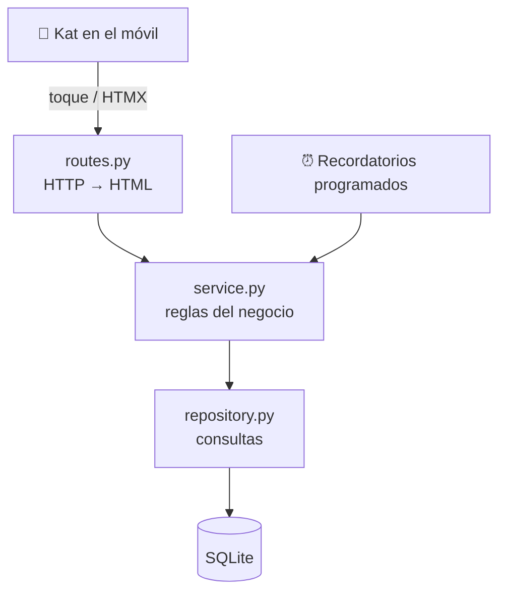

# Arquitectura

## En una frase
Un **monolito modular**: una sola app desplegable, dividida por dominios (alumnos, clases,
asistencia, pagos...), y dentro de cada dominio, tres capas con responsabilidades separadas.

## Capas

| Capa | Responsabilidad | Prohibido |
|---|---|---|
| `routes.py` | Recibir la petición, validar la entrada, llamar al service y devolver HTML o un fragmento HTMX | Tocar la BD, calcular reglas de negocio |
| `service.py` | Reglas del negocio: "¿cuánto debe?", "genera las clases de la semana" | Importar nada de FastAPI |
| `repository.py` | Leer y escribir en la BD | Decidir reglas |

**Por qué:** si la lógica no sabe nada de HTTP, se prueba con un test de una línea y sin
servidor, y la puede reutilizar cualquier otro "cliente" (el programador de recordatorios, un
script, una futura API JSON) sin copiar código.

**Dirección de las dependencias:** siempre hacia abajo. `routes` conoce a `service`, `service`
conoce a `repository`, y nunca al revés. `core/` puede ser usado por todos, pero `core/` no
importa ningún módulo de dominio.

## Módulos (por dominio, no por tipo de archivo)
Agrupar por dominio (`students/` con sus modelos, rutas y plantillas) en lugar de por tipo
(`models/`, `routes/`...) hace que una funcionalidad viva en una sola carpeta. Si algún día un
módulo necesitara vivir aparte (por ejemplo, `reminders` como un worker), ya tiene sus fronteras
dibujadas: se mueve la carpeta y se cambia la llamada directa por una cola o una API.

## Camino de escalado
1. **Hoy:** un proceso + SQLite (WAL) + un servidor pequeño.
2. **Varias profes o ubicaciones:** `teacher_id` / `location_id` y PostgreSQL (con SQLModel el
   cambio es casi solo la `DATABASE_URL`).
3. **App nativa o integraciones:** los mismos services expuestos como API JSON (FastAPI genera
   la documentación OpenAPI sola).

Decisiones: [ADR-0001](adr/0001-monolito-modular.md).
