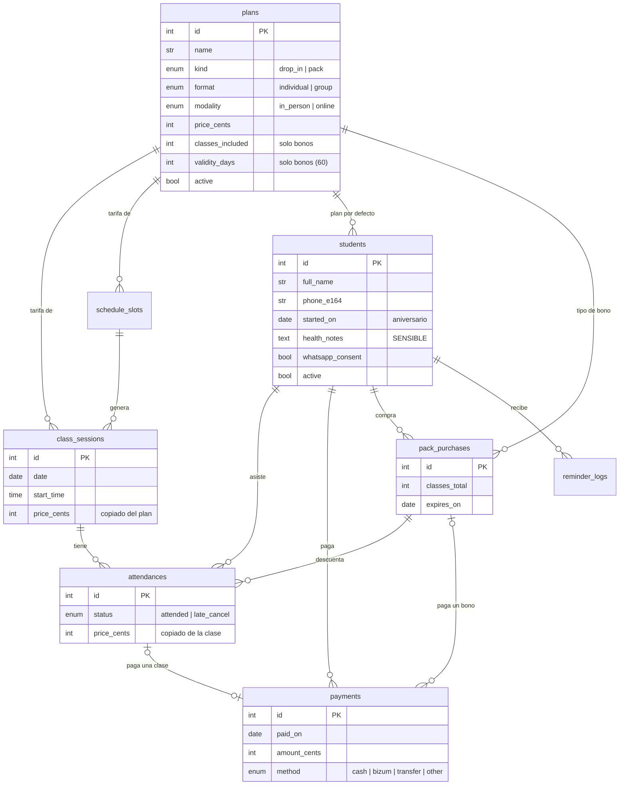

# Modelo de datos

## Reglas
- **Dinero en céntimos (`int`)**. Nunca `float`. Ver `core/money.py` y [ADR-0003](adr/0003-modelo-de-datos.md).
- **Los precios se copian** (plan → clase → asistencia). Cambiar una tarifa no reescribe el pasado.
- **Lo derivado no se guarda.** Saldo = Σ asistencias − Σ pagos (o clases que le quedan del bono).
  Se calcula en `payments/service.py` (Fase 3).
- **`legacy_id`** guarda el ID del Excel (`ALU-0001`, `CLA-0001`, `REG-0001`, `PLA-01`). Es lo
  que hace la importación idempotente.
- **`UNIQUE(class_session_id, student_id)`**: nadie puede estar dos veces en la misma clase. Lo
  garantiza la base de datos, no la interfaz.
- **`health_notes`** es un dato de salud (RGPD): solo se muestra en la ficha, nunca en listados ni
  en logs.
- **`late_cancel`**: cancelación con menos de 2 h de aviso. No vino, pero se cobra o se descuenta
  del bono (norma de la lista de precios 2026).

## Catálogo de tarifas (2026, Valdebebas)

| Plan | Suelta | 4 clases | 8 clases |
|---|---:|---:|---:|
| Individual presencial | 35 € | 120 € | 216 € |
| Individual online | 20 € | 72 € | 144 € |
| Grupal presencial (desde 3 pers.) | 30 € | 108 € | 200 € |

Los bonos duran 60 días desde el pago. En el código están en `classes/catalog.py`. Los dos planes
del Excel ("Clase individual" a 30 € y "Grupo Reggio" a 21 €) se importan como **históricos e
inactivos**, para que las clases antiguas conserven su precio.

## Importación del Excel
`uv run python scripts/import_excel.py` aplica las migraciones, importa y escribe
`data/import_report.md` (fuera de git). El informe solo contiene IDs y cifras, nunca nombres.

**Por qué RESUMEN_MENSUAL no cuadra (1 de 37 alumnos):** en la hoja, la fórmula de la fila de
`ALU-0001` es distinta a las demás. Filtra por `CONFIG!Mes_Activo` (marzo de 2026), mientras que
el resto de filas cuentan todo el histórico. Por eso el resumen le asigna 2 clases (las de marzo)
en lugar de 8. La fuente de verdad es `CONTROL_DIARIO`, registro a registro: 56 asistencias y
1.194 €.
